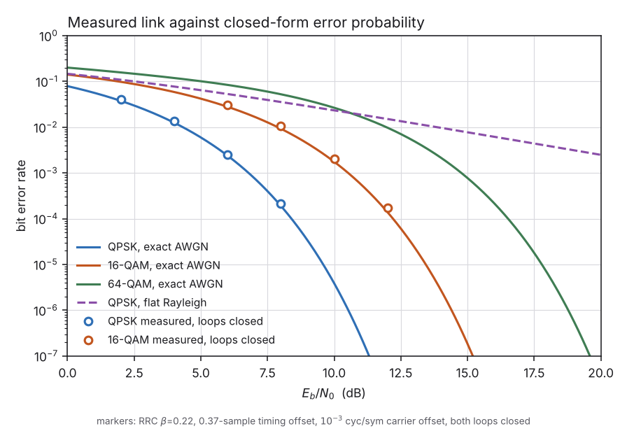
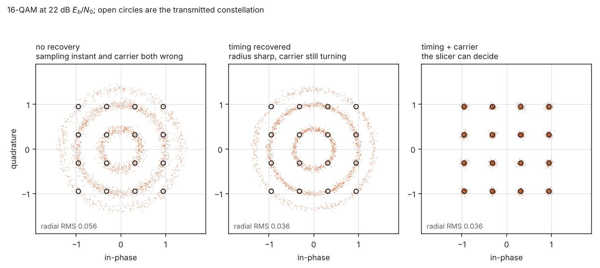
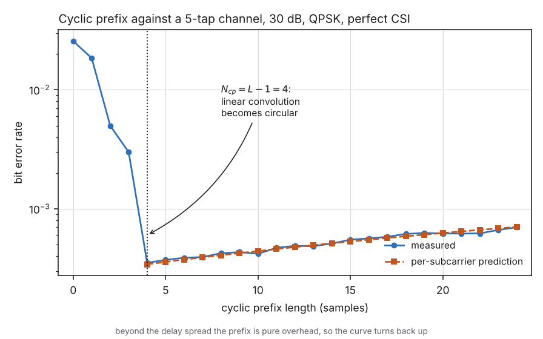

# Constellation

**A digital communications link built end to end — modulation, pulse shaping, timing and carrier recovery, OFDM — with every performance claim checked against a closed-form error probability.**

A link simulator that is one decibel optimistic is worse than no simulator, because it looks right. So nothing here is asserted: each stage is measured against an analytic result that was derived independently, and the suite fails if they disagree.

```console
$ python3 -m constellation link --M 16 --snr 12 --bits 600000
16-QAM at 12 dB, 600,000 bits
  bit errors          110 -> BER 1.8333e-04
  analytic BER        1.3866e-04   ratio 1.322
  implementation loss +0.18 dB
  EVM                 -17.91 dB
  frame offset        0 symbols (peak ratio 7.0)
  sampling phase      +0.384 samples (injected +0.37), jitter 0.046
  frequency estimate  +9.115e-04 cyc/sym (injected +0.001)
```

Every number below was produced by `python3 bench/run_all.py`. Nothing is quoted from a textbook.



**366 tests total: 353 passed, 13 skipped.** 2,000 lines of library and C, 1,500 of tests, 570 of benchmarks.

---

## 1. The analytic reference, and a bug in it

Everything else is measured against `theory.py`, so if the yardstick is wrong, every other test agrees with it and nothing is verified. It is therefore computed exactly rather than approximated: square QAM factors into two independent Gray-coded PAM arms, so the bit error probability is obtained by integrating the Gaussian over every decision region and weighting by Hamming distance. No high-SNR approximation, no union bound.

For M = 4 that enumeration must collapse to the textbook `Q(sqrt(2 Eb/N0))`. It does:

| Eb/N0 | enumerated | closed form | rel. diff |
|---:|---:|---:|---:|
| 0 dB | 7.86496035e-02 | 7.86496035e-02 | 0 |
| 8 dB | 1.90907774e-04 | 1.90907774e-04 | 0 |
| 16 dB | 2.26739584e-19 | 2.26739584e-19 | 7.0e-15 |
| 24 dB | 1.44441907e-111 | 1.44441907e-111 | 1.1e-13 |
| 28 dB | 1.06846074e-276 | 1.06846074e-276 | 0 |

Worst relative difference **1.1e-13**, down to a BER of 1e-276.

It did not start that way. Written the obvious way, as a difference of CDFs, it returned **exactly half** the right answer above 14 dB. `Φ(9)` differs from 1.0 by 1e-19, which is far below float64 resolution at 1.0, so the subtraction returned zero: the error probability for the level *below* a decision boundary vanished while the one above it survived as a left tail. A factor of two, invisible at low SNR — which is what made it dangerous. Each region is now integrated from whichever end does not cancel.

As a second, independent check, the exact 16-QAM result matches the standard `(3/8)erfc(sqrt(Eb/N0 / 2.5))` approximation to five decimals above 8 dB — and departs from it by 1.3% at 0 dB, where the neglected second-order term matters. Agreeing everywhere would have meant it was the same approximation in disguise.

---

## 2. The link, measured

RRC β = 0.22, span 10, 8 samples per symbol, a 0.37-sample sampling offset, a carrier offset of 1e-3 cycles per symbol and an initial phase of 0.9 rad — with both loops closed and the receiver recovering all of it.

| Eb/N0 | ideal sync | loops closed | theory | implementation loss |
|---:|---:|---:|---:|---:|
| QPSK, 2 dB | 3.5446e-02 | 3.9197e-02 | 3.7506e-02 | **+0.10 dB** |
| QPSK, 6 dB | 2.2171e-03 | 2.8301e-03 | 2.3883e-03 | **+0.17 dB** |
| QPSK, 8 dB | 1.8467e-04 | 2.1433e-04 | 1.9091e-04 | **+0.08 dB** |
| 16-QAM, 6 dB | 2.7179e-02 | 3.0524e-02 | 2.7871e-02 | **+0.21 dB** |
| 16-QAM, 10 dB | 1.8243e-03 | 2.1752e-03 | 1.7542e-03 | **+0.22 dB** |
| 16-QAM, 12 dB | 1.4300e-04 | 1.5600e-04 | 1.3866e-04 | **+0.08 dB** |

The loss is quoted as a horizontal shift in dB, not a BER ratio. A ratio changes meaning with the slope of the curve; a decibel does not.

The scaling convention that makes this comparison possible is stated once and enforced by test: complex noise variance `σ² = 1/(m · Eb/N0)` for unit-energy symbols. Because the receive filter has unit energy, that same `σ²` reaches the slicer whatever the oversampling factor — so **a BER measured at 2, 4 and 8 samples per symbol must be identical**, which is the cheapest available guard against a silent decibel error anywhere in the chain.

---

## 3. Acquisition: three failures that look like success



A rotating carrier smears every panel into rings, which hides what the timing loop fixed. Radial error is invariant to rotation, so it isolates the timing and ISI part: **0.056 → 0.036 → 0.036**. Timing recovery cuts it by a third; carrier recovery adds nothing radially, because it only fixes angle. That is the right answer, and it is a number rather than a squint.

Each of the three receiver failures below produces a BER near 0.5 while every loop metric looks healthy.

**Frame misalignment.** Deriving the frame start from filter lengths works until any filter changes. A one-symbol slip makes the known preamble correlate against essentially random signs, so the frequency estimate becomes a random number — measured at 0.34 cycles/symbol against a true 1e-3 — and the carrier loop faithfully locks to it. The timing loop reports a textbook lock throughout. `find_preamble` correlates for the real offset and returns a peak-to-background ratio, so a failure to find the frame is visible instead of silently returning lag zero.

**Rotational ambiguity.** A decision-directed loop on square QAM is equally happy 90, 180 or 270 degrees off, because a rotated square constellation is the same set of points — the error signal is zero at all four lock points:

| injected phase | with preamble | blind |
|---:|---:|---:|
| 0 | 0.0000e+00 | 1.7500e-03 |
| π/2 | 0.0000e+00 | 5.0350e-01 |
| π | 0.0000e+00 | 5.0025e-01 |
| 3Ï€/2 | 0.0000e+00 | 5.0125e-01 |

Only known symbols break the tie. This is why every real standard sends a preamble.

**Timing self-noise.** The Gardner detector's error signal depends on the data, so random symbols drive the loop with a residual it cannot distinguish from a real timing error. Measured with *no noise at all*, jitter runs 0.005 samples at zero offset to 0.07 at ±0.45. It is irreducible at a given loop bandwidth, and narrowing the loop to shrink it slows acquisition.

Gardner is used rather than Mueller–Müller precisely because its error signal is independent of carrier phase, so it can lock before the carrier loop does. Measured: a carrier rotation of 0.00, 0.87 and 2.40 rad all give a recovered sampling phase of **+0.2708**.

### A correction worth recording

The frequency estimator was switched to the repeated-preamble (Moose/Schmidl–Cox) form at the same sitting as frame sync was added, and the change was credited with fixing that 0.5 BER on the theory that payload ISI biased the lag-1 estimator in proportion to peak-to-average power.

Measured, that explanation is false. The lag-1 bias on a pulse-shaped preamble is 6.5e-6 for QPSK, 4.9e-6 for 16-QAM and 2.7e-6 for 64-QAM — **no trend with constellation order**, and three orders of magnitude too small to matter. The real cause was the missing frame sync, and both estimators work once the frame is aligned. Two things were changed at once and the wrong one got the credit.

The claim that survives measurement is variance. One correlation at lag 32 beats 63 correlations at lag 1, because the phase being measured has had 32 symbols to accumulate:

| Eb/N0 | lag-1 std | repetition std | ratio |
|---:|---:|---:|---:|
| 0 dB | 7.52e-03 | 8.14e-04 | **9.2×** |
| 8 dB | 1.34e-03 | 2.92e-04 | **4.6×** |
| 20 dB | 1.91e-04 | 7.18e-05 | **2.7×** |

The advantage grows as SNR falls, which is where acquisition is hard. Neither estimator is measurably *biased*: over 4000 trials each mean sits within its own standard error of zero. An earlier draft quoted a bias figure from a single seed, which was a two-sigma fluctuation reported as a finding.

The capture range is stated rather than hidden: unambiguous only for |f| < 1/(2·32) = 0.0156 cycles/symbol, and at 0.0312 it wraps and returns zero.

---

## 4. OFDM

Prepend a copy of each block's tail longer than the channel's delay spread and linear convolution becomes **circular**, which is diagonal in the DFT basis — so a frequency-selective channel becomes one complex multiply per subcarrier that a single divide undoes.



That is demonstrated quantitatively rather than asserted. With a sufficient prefix and perfect channel knowledge there is no residual ISI, so the BER is *forced* to equal the average over subcarriers of the AWGN error rate at each subcarrier's own SNR. That prediction is exact over a frequency-selective channel, not an inequality:

| Eb/N0 | measured | predicted | ratio |
|---:|---:|---:|---:|
| 6 dB | 6.3663e-02 | 6.3659e-02 | 1.0001 |
| 14 dB | 2.3993e-02 | 2.4011e-02 | 0.9993 |
| 22 dB | 7.5379e-03 | 7.5362e-03 | 1.0002 |

which leaves cyclic-prefix sufficiency as the only thing that can fail. The threshold is sharp and lands exactly where theory says — more than an order of magnitude between 3 and 4 on a 5-tap channel — and past it the BER creeps **back up**, because prefix beyond the delay spread is pure overhead. Below the threshold the floor is irreducible: raising SNR from 20 dB to 40 dB, a 100× change in noise power, improves n_cp = 0 by 1.1× and n_cp = 1 by 1.2×.

**Energy bookkeeping**, which is where OFDM simulations usually go wrong. The prefix is transmitted energy carrying no new information and the pilots carry no data, so the useful Eb/N0 is below the channel Eb/N0 by exactly `10log10((N + N_cp)/D)` — 1.549 dB here. Over a flat channel the measured BER matches AWGN theory shifted by precisely that, to within 1%. Omitting the term is what makes an OFDM curve appear to beat single-carrier QAM, which cannot happen.

### Where the estimator floor comes from

| Eb/N0 | perfect CSI | transform domain | linear interpolation |
|---:|---:|---:|---:|
| 8 dB | 4.9587e-02 | 7.7257e-02 (1.56×) | 8.5684e-02 (1.73×) |
| 16 dB | 1.8453e-02 | 2.9465e-02 (1.60×) | 6.0998e-02 (3.31×) |
| 24 dB | 5.1228e-03 | 9.5920e-03 (1.87×) | 5.4942e-02 (**10.72×**) |

Linear interpolation's penalty grows without bound while the transform-domain estimator's stays flat. The tempting diagnosis — too few pilots — is wrong: a spacing of 8 satisfies the sampling theorem for a 5-tap channel, which needs spacing below N/L = 12.8. A straight line is simply not the reconstruction filter the sampling theorem calls for. The channel response between pilots is curved, linear interpolation cuts the corner, and the residual is a *modelling bias* that does not shrink with SNR. Solving instead for the channel's time-domain taps — with uniformly spaced pilots that is a DFT submatrix, so least squares recovers up to P taps exactly — costs a fixed noise penalty and no floor. It is what a real receiver does, and the assumption it rests on, a bounded delay spread, is the same one that sized the prefix.

---

## 5. The C receiver: where compiled code helps, and where it does not

| stage | NumPy / Python | C | speedup |
|---|---:|---:|---:|
| Gardner timing loop | 134.14 ms | 1.71 ms | **78.4×** |
| 16-QAM slicer | 1.18 ms | 0.28 ms | 4.1× |
| FIR matched filter | 9.60 ms | 19.40 ms | **0.5×** |
| bit error count | 0.02 ms | 0.12 ms | **0.1×** |

Only the first row is a real win, and the reason is structural: each strobe depends on the loop state the previous one left, so there is no array operation that computes them together and the Python version pays interpreter overhead per symbol. The other three were already compiled inside NumPy — the filter is *slower* in C than `np.convolve`, and the bit counter is several times slower because one ctypes call costs more than the whole vectorised comparison. Rewriting those in C would have been effort spent making the code worse. They are kept as measured negative results. (Speedups vary by a few tens of percent between runs; `bench/run_all.py native` reproduces them.)

The two paths are **bit-identical**, not merely close — every strobe, every sampling-phase estimate, every decision. Anything less would mean a BER measured with the fast path is not the BER of the reference receiver. Getting there required `nearbyint` rather than `llround` in the slicer: they differ on exact ties, where `np.rint` rounds half to even and `llround` rounds half away from zero. Ties have measure zero once there is noise, so this would never have surfaced in a BER number — only a direct comparison found it.

The C library is compiled on first use and the package falls back to NumPy if no compiler is present. It is an optimisation, not a dependency.

---

## What this does not do

- **No coding.** Uncoded BER throughout. OFDM converts one frequency-selective channel into many flat ones; it provides no diversity by itself, so without coding across subcarriers the deep fades carry nearly all the errors. Coding is what recovers that, and it is not here.
- **Flat fading is validated on the memoryless channel**, not the pulse-shaped link — because that is the model the closed form describes. A fade redrawn every symbol is *not* flat once the signal is pulse-shaped: the matched filter integrates across ten different gains. Measured, a 40-symbol fade block sits 2.2× above the analytic curve at 18 dB purely from symbols near a fade boundary, while the memoryless path agrees to 0.6% from 6 to 22 dB. The gap is a modelling mismatch, not a receiver defect, so it is asserted in a test rather than tuned away.
- **No equaliser on the single-carrier link.** A symbol-spaced echo is fatal to it at any SNR — which is the motivation for the OFDM chain. Note that selectivity is relative to the symbol rate, not a property of a tap list: the same 5-tap channel spans half a symbol at 8 samples per symbol (a sub-symbol echo the matched filter largely absorbs) and 5 of 64 subcarriers in the OFDM chain (genuinely frequency-selective).
- **Timing recovery tracks phase, not rate.** A sampling-frequency offset would need the full interpolator-controller; only a static offset and slow drift are handled.
- **Frequency acquisition is single-stage**, so the capture range is 1/(2·32) cycles per symbol. Real receivers use a short repetition for coarse acquisition and a long one to refine.
- **Truncated filters are only approximately Nyquist.** Residual ISI falls with span slowly and *non-monotonically* — at β = 0.35 a span of 6 gives 7.1e-3 but a span of 8 gives 3.6e-2 — because it depends on where the cut lands relative to the zero crossings of the tail. Doubling the span does not reliably halve the ISI, which is why real modems settle at 8 to 12 symbols rather than 32.

---

## Run it

```bash
pip install -e ".[dev]"

pytest                                  # 366 tests
python3 bench/run_all.py                # every table above
python3 bench/run_all.py ofdm native    # one or more studies
python3 bench/make_figures.py           # the three figures

python3 -m constellation ber  --M 16 --snr 6:14:2
python3 -m constellation link --M 16 --snr 12
python3 -m constellation ofdm --snr 10,18 --n-cp 16
python3 -m constellation info
```

## Layout

```
constellation/theory.py      exact Gray-QAM BER by region integration; Rayleigh closed form
constellation/modulation.py  Gray mapping, ML per-dimension slicer, EVM
constellation/pulse.py       root-raised-cosine, Nyquist residual, ISI floor
constellation/channel.py     AWGN at a stated Eb/N0, Rayleigh, multipath, front-end offsets
constellation/sync.py        Gardner timing loop, frame sync, frequency estimation, carrier PLL
constellation/ofdm.py        cyclic prefix, pilots, two channel estimators, ZF equalisation
constellation/link.py        the assembled link, plus the memoryless reference path
constellation/_native.py     loader for the C receiver, with a NumPy fallback
csrc/receiver.c              FIR, Gardner loop, QAM slicer
tests/                       366 tests
bench/run_all.py             produces every number in this README
bench/make_figures.py        produces every figure in this README
```

## License

MIT

